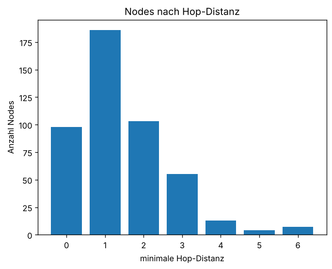
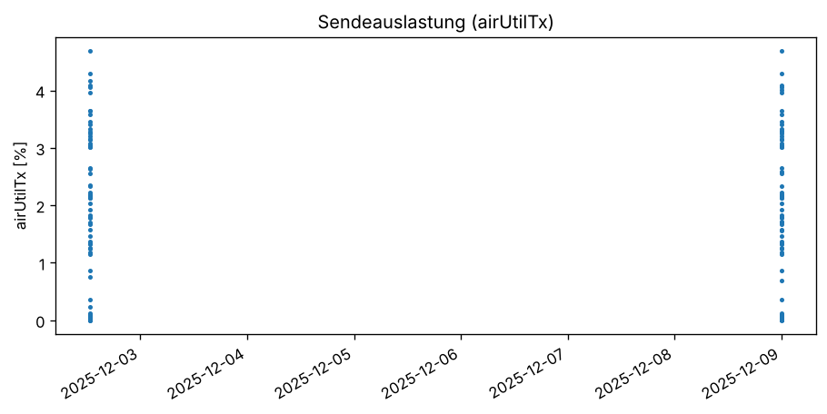

# Meshtastic Netzwerkanalyse Dresden

Projekt aus dem Projektseminar an der HTW Dresden (WS 2025/26).
Frage war, ob Meshtastic im Raum Dresden als unabhängiges Notfall-Netz taugt.
Mein Teil: Pakete aus dem echten Netz mitschneiden und auswerten –
wie viele Nodes gibt es, wie weit sind sie entfernt (Hops), welche sind mobil,
wie stark ist der Kanal ausgelastet.

Hardware: LilyGO T-Echo (nRF52840 + SX1262), Firmware Meshtastic 2.x.

## Aufbau

```
sniffer/    cli_sniffer.py   – liest `meshtastic --listen` und loggt Pakete, Nodes, airUtilTx
analysis/   hops.py          – Hop-Distanzen pro Node aus der SQLite-DB
            mobility.py      – welche Nodes oft Positionen senden (= vermutlich mobil)
            airutil.py       – Diagramm der Sendeauslastung
docs/       Notizen zum Paketaufbau, Diagramme
```

## Installation

```
pip install -r requirements.txt
```

## Benutzung

Sniffer (Gerät per USB verbunden):

```
python sniffer/cli_sniffer.py --port COM3 --out logs
```

Auswertung (braucht eine SQLite-DB mit Tabelle `rawpackets`, Spalten u.a.
`from`, `hopStart`, `hopLimit`, `mqtt`, `port`):

```
python analysis/hops.py meshtastic.db --plot
python analysis/mobility.py meshtastic.db
python analysis/airutil.py logs/airutil.csv
```

## Ergebnisse

Datengrundlage: ca. 190.000 Rohpakete, aufgenommen über ~11 Tage im Dezember 2025
mit einem Gerät in Dresden. Die Rohpakete wurden mit einem Logger aus dem Team
(modifizierte Firmware) in SQLite gespeichert, die Auswertung ist von mir.



Nach Filterung bleiben **466 Nodes** mit mindestens 5 Paketen.
Die meisten sind 1–2 Hops entfernt, ab 4 Hops wird es sehr wenig.
Das passt dazu, dass Meshtastic standardmäßig mit hopLimit 3 sendet
(manche Nodes haben es höher eingestellt, daher die 5–7).

Bei 0 Hops sind trotzdem fast 100 Nodes – das ist mehr als ich als direkte
Nachbarn erwartet hätte. Ist noch nicht geklärt, vielleicht senden manche
Geräte mit hopStart = hopLimit oder der Filter reicht noch nicht.

Sendeauslastung (airUtilTx) lag bei meinem Gerät im Schnitt bei ~1,4 %, max 4,7 %:



### Problem mit den Rohdaten

Mein erster Versuch (`hops_counter`) hat über **5000 Nodes** gezählt,
davon über 700 mit 0 Hops. Das kann für Dresden nicht stimmen.
Beim Nachschauen in der DB: ca. 4400 Node-IDs kommen **nur ein einziges Mal** vor.
Das sind kaputte Pakete (Funkstörungen), bei denen das `from`-Feld zufälliger Müll ist.
Außerdem waren Pakete mit MQTT-Flag drin, die gar nicht direkt per Funk kamen.

Deswegen filtert `hops.py` jetzt standardmäßig:
- Nodes mit weniger als 5 Paketen (`--min-packets`)
- Pakete mit MQTT-Flag (`--with-mqtt` um sie mitzunehmen)

## Probleme / was ich gelernt habe

- Mit der normalen Firmware kommt man nicht an Rohpakete ran. Ich habe lange versucht,
  `debugLogApiEnabled` zu aktivieren, die Einstellung wurde aber nicht übernommen.
  Gelöst wurde es im Team über eine angepasste Firmware, die Rohpakete auf die Konsole schreibt.
- Nach einem Reflash war der COM-Port unter Windows zwar sichtbar, aber die CLI
  hat sich nicht mehr verbunden. Bluetooth ging weiter. Teilweise lag es auch an
  meinem Code (ein Teil wurde gar nicht ausgeführt), hat eine Weile gedauert das zu finden.
- Die CLI-Ausgabe ist kein sauberes JSON (Python-dicts mit `'`, Bytes usw.),
  deshalb sucht der Sniffer selbst nach Klammern und probiert erst JSON und dann `ast.literal_eval`.

## Datenschutz

Die DB und Logs enthalten Gerätenamen, MAC-Adressen und GPS-Positionen von echten
Leuten. Deswegen sind sie **nicht** im Repo (siehe `.gitignore`).

## TODO

- 0-Hop-Nodes genauer anschauen
- Positionen auf Karte (nur aggregiert)
- Sniffer direkt in SQLite schreiben lassen statt Textdateien
